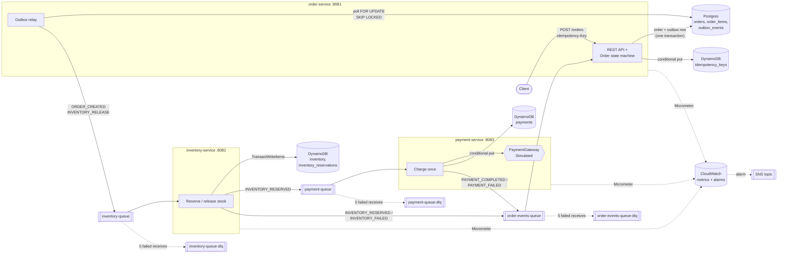
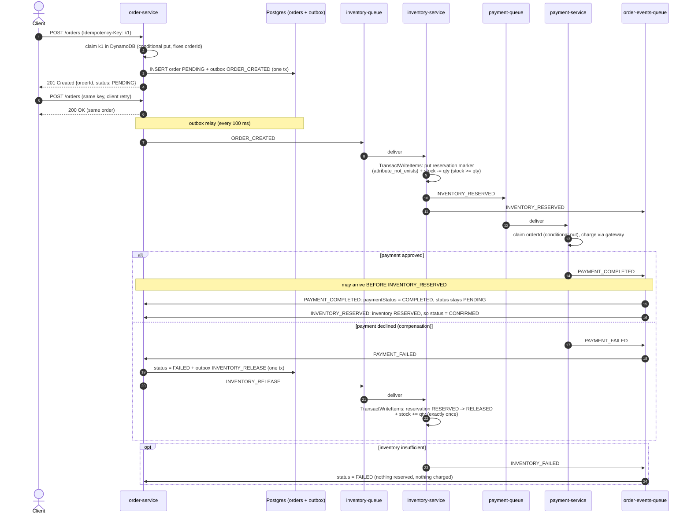

# Order Processing Microservices

[](https://github.com/masroorahmed402/order-processing-system/actions/workflows/ci.yml)


An event-driven order system built as a **choreographed saga** across three Spring Boot
microservices that talk to each other **only through Amazon SQS**. Orders live in Postgres
(written together with a **transactional outbox**), stock and payments live in DynamoDB, and
every hop is **idempotent**: the API (Idempotency-Key), inventory (one `TransactWriteItems` that
writes a dedupe marker and decrements stock together) and payments (conditional put, so an order
is charged at most once). Consumers retry with **exponential backoff** and dead-letter after five
attempts, payment failures trigger a **compensating stock release**, and the order state machine
tolerates **out-of-order and duplicate delivery**. Everything runs locally on LocalStack, is
covered by Testcontainers tests, and has been load-tested with
**1,000 concurrent orders plus 1,000 client retries: 0 errors, 0 duplicates, 0 lost orders**
([results](docs/load-test-results.md)).

---

## Contents

- [Architecture](#architecture)
- [The saga](#the-saga)
- [Key design decisions and trade-offs](#key-design-decisions-and-trade-offs)
- [Quick start](#quick-start)
- [API](#api)
- [Tests](#tests)
- [Load test](#load-test)
- [Results](#results)
- [Observability](#observability)
- [Runbook](#runbook)
- [How it maps to AWS](#how-it-maps-to-aws)
- [Project structure](#project-structure)

---

## Architecture



- **No service calls another over HTTP.** The only coupling is the event contract in `common/`
  (`OrderEvent`, `EventType`, `QueueNames`).
- Every work queue has a dead-letter queue (`RedrivePolicy`, `maxReceiveCount = 5`).
- Locally, LocalStack provides SQS, DynamoDB, CloudWatch and SNS; Postgres stands in for RDS.

## The saga

Happy path, out-of-order delivery and the compensation path:



Order status: `PENDING → INVENTORY_RESERVED → CONFIRMED`, or `→ FAILED`. The order tracks
`inventoryStatus` and `paymentStatus` separately and derives `status` from them, which is what
makes arrival order irrelevant.

## Key design decisions and trade-offs

**Transactional outbox.** `POST /orders` writes the order and an `outbox_events` row in the same
Postgres transaction; `OutboxPublisher` relays rows to SQS (`FOR UPDATE SKIP LOCKED`, so several
instances can relay in parallel). That removes the dual-write problem: an order can never exist
without its event, and an event is never sent for a rolled-back order. The cost is a little extra
latency (≤100 ms poll interval) and at-least-once publishing (a crash between send and commit
re-sends), which every consumer tolerates. The compensating `INVENTORY_RELEASE` uses the same
outbox, in the same transaction as the `FAILED` status change. The alternative, CDC (Debezium) on
the WAL, avoids polling but adds Kafka Connect to operate.

**Choreography, not orchestration.** Each service reacts to events and emits its own. There is
no central coordinator to deploy, scale or fail, and services stay decoupled. The trade-off is
that the flow is implicit (you read it from the sequence diagram, not from one class) and
debugging spans three services. With more steps or branching, an orchestrator such as AWS Step
Functions or Temporal would become worth it. Three steps with one compensation is the sweet spot
for choreography.

**Idempotency at every hop.** SQS standard queues deliver at least once, and clients retry.
- *API:* `Idempotency-Key` is claimed in DynamoDB with `attribute_not_exists`. The claim also
  stores a pre-generated `orderId` and a SHA-256 fingerprint of the body. Racing duplicates all
  map to the same id, which is the Postgres primary key, so two orders for one key are impossible
  even under concurrency. Replays get `200` and the original order, a different body gets `422`,
  an in-flight duplicate waits up to 3 s and then gets `409`. Keys expire after 24 h (DynamoDB TTL).
- *Inventory:* one `TransactWriteItems` writes a reservation marker (`attribute_not_exists(orderId)`)
  **and** decrements every SKU (`stock >= :qty`). Both happen or neither. A duplicate fails the
  marker condition and re-publishes the stored outcome instead of re-evaluating stock. Release
  flips `RESERVED → RELEASED` in the same transaction as the increment, so stock is restored at
  most once and only if it was actually reserved.
- *Payment:* a conditional put claims `orderId` before the gateway is called, the order id is
  passed as the gateway's idempotency key, and the result is stored conditionally. Each order is
  charged at most once; duplicates re-publish the stored result.
- *Order:* the state machine ignores duplicates and stale events (`mark*` methods return `false`).

**At-least-once delivery + idempotent consumers** instead of SQS FIFO: FIFO's exactly-once is
per 5-minute dedupe window and caps throughput per message group. Idempotent consumers are
needed anyway (redrives, outbox re-sends, operator replays), so standard queues plus idempotency
give unbounded throughput with the same guarantees.

**Out-of-order handling.** Inventory publishes `INVENTORY_RESERVED` to payment and to the order
queue at the same time, so `PAYMENT_COMPLETED` can overtake it. The `Order` aggregate records
inventory and payment outcomes independently and confirms when both are in, in either order.
Concurrent updates to one order are caught by optimistic locking (`@Version`) and retried
in-process (up to 5 times with jitter) before falling back to SQS backoff.

**Exponential backoff + DLQ.** On a transient failure `BackoffErrorHandler` sets the message's
visibility timeout to `min(base × 2^(receiveCount − 1), 300 s)` (2 s, 4 s, 8 s, 16 s…) and does
not acknowledge it. After 5 receives the queue's redrive policy moves it to the DLQ. **Permanent**
failures (malformed JSON, missing fields, wrong event type for the queue) are copied straight to
`<queue>-dlq` with `x-failure-reason` and `x-source-queue` attributes and acknowledged, because
retrying them five times only delays the alarm. Everything else is treated as transient. The
calculation lives in `ExponentialBackoff` with its own unit tests, and an end-to-end test proves
5 attempts with growing gaps followed by the DLQ.

**Postgres for orders, DynamoDB for inventory, payments and idempotency keys.** Orders are
relational (header + items), are queried in flexible ways (status dashboards, reconciliation,
support lookups) and need multi-row transactions with the outbox, so a relational database
(RDS) fits. Inventory, payments and idempotency keys are single-key, high-write, contention-heavy
access patterns where DynamoDB's conditional writes and `TransactWriteItems` give atomic
check-and-set without row locks, with predictable latency at any scale and no connection pools to
exhaust. The trade-off is two persistence technologies to operate, and no cross-store
transaction, which the saga and idempotency design make unnecessary.

**OO boundaries.** State transitions live in the `Order` aggregate; repositories
(`OrderRepository`, `InventoryRepository`, `PaymentRepository`, `IdempotencyStore`) and the
`PaymentGateway` sit behind interfaces. Controllers and `@SqsListener` methods only translate
HTTP or messages and delegate, so there is no business logic in them.

## Quick start

Prerequisites: Java 21, Maven 3.9+, Docker (running). k6 is optional (the load test runs k6 in a
container by default).

```bash
# 1. Build the service jars
mvn -B -DskipTests package

# 2. Start Postgres, LocalStack (queues, DLQs, tables and seed stock are created on startup)
#    and the three services, and wait until all are healthy
docker compose --profile apps up -d --build --wait

# 3. Place an order (seeded SKUs: SKU-001 = 100 units, SKU-002 = 50, SKU-LOW = 2, SKU-LOAD = 1,000,000)
curl -s -X POST localhost:8081/orders \
  -H 'Content-Type: application/json' -H 'Idempotency-Key: demo-1' \
  -d '{"customerId":"c-42","items":[{"sku":"SKU-001","quantity":2,"unitPrice":19.99}]}'

# 4. Tear down (also deletes the data volumes)
docker compose --profile apps down -v
```

To run a service from your IDE instead, start only the infrastructure with `docker compose up -d`
and run `OrderServiceApplication` (or the others). The default `local` profile points at
`localhost:5432` and LocalStack on `localhost:4566`.

## API

Create an order. The `Idempotency-Key` header is required:

```bash
curl -s -i -X POST localhost:8081/orders \
  -H 'Content-Type: application/json' -H 'Idempotency-Key: demo-2' \
  -d '{"customerId":"c-42","items":[{"sku":"SKU-001","quantity":2,"unitPrice":19.99}]}'
```
```http
HTTP/1.1 201
Location: /orders/3f2c1d8e-...
{"orderId":"3f2c1d8e-...","customerId":"c-42","status":"PENDING","inventoryStatus":"PENDING",
 "paymentStatus":"PENDING","totalAmount":39.98,"items":[{"sku":"SKU-001","quantity":2,"unitPrice":19.99}],...}
```

| Request | Response |
|---|---|
| Same key, same body (client retry) | `200 OK`, the original order |
| Same key, different body | `422 Unprocessable Entity` |
| Same key while the first request is still running (>3 s) | `409 Conflict` (retry later) |
| Missing/blank `Idempotency-Key`, invalid body | `400 Bad Request` (RFC 7807 problem JSON) |

Get an order:

```bash
curl -s localhost:8081/orders/<orderId>
# {"orderId":"...","status":"CONFIRMED","inventoryStatus":"RESERVED","paymentStatus":"COMPLETED",...}
```

Try the failure paths:

```bash
# Insufficient stock -> FAILED (SKU-LOW has 2 units)
curl -s -X POST localhost:8081/orders -H 'Content-Type: application/json' -H 'Idempotency-Key: demo-low' \
  -d '{"customerId":"c-42","items":[{"sku":"SKU-LOW","quantity":5,"unitPrice":1.00}]}'

# Payment declined (> 5000.00) -> FAILED, and the reserved stock is released again
curl -s -X POST localhost:8081/orders -H 'Content-Type: application/json' -H 'Idempotency-Key: demo-big' \
  -d '{"customerId":"c-42","items":[{"sku":"SKU-002","quantity":2,"unitPrice":3000.00}]}'
```

Read-only operator endpoints: `GET localhost:8082/inventory/{sku}`,
`GET localhost:8082/inventory/reservations/{orderId}`, `GET localhost:8083/payments/{orderId}`,
plus `POST localhost:8081/admin/orders/{orderId}/resume` (see [Runbook](#runbook)).
Every service exposes `/actuator/health` and `/actuator/metrics`.

## Tests

```bash
mvn -B verify                       # unit + integration + end-to-end tests, JaCoCo reports
python3 scripts/coverage-summary.py # coverage per package from the aggregate report
```

`mvn verify` needs Docker: integration tests use **Testcontainers** (Postgres 16 + LocalStack,
bootstrapped with the same `infra/localstack/init-aws.sh` as docker-compose).

| Layer | What it proves |
|---|---|
| Unit (JUnit 5, Mockito) | `Order` state machine incl. out-of-order and duplicates; `ExponentialBackoff`; idempotent placement, fingerprints; payment gateway; event serialization and malformed input; error classification; outbox batching |
| Module integration (`*IT`, real Postgres/LocalStack) | API idempotency (replay 200, reuse 422, 20 concurrent same-key requests create 1 order); outbox relay; out-of-order and duplicate saga events; atomic multi-item reservation; no overselling under 50 concurrent reservations; release restores stock once; 5 concurrent duplicate payment deliveries charge once |
| End-to-end (`e2e-tests`, all three services in one JVM, each its own Spring context) | happy path CONFIRMED; insufficient stock FAILED; payment decline FAILED **and** stock restored; duplicate API calls create one order; duplicate SQS deliveries cause no double reservation or charge; 12 concurrent orders for 5 units never oversell; **transient failure rate 1.0 means 5 attempts with growing gaps, then `payment-queue-dlq`, then redrive confirms the order**; malformed messages skip retries and go straight to the DLQ |

Coverage (JaCoCo, unit + integration + e2e, aggregated in `e2e-tests/target/site/jacoco-aggregate`):
see [Results](#results).

## Load test

```bash
scripts/run-load-test.sh
```

One command: builds the jars, starts a **fresh** stack (Postgres, LocalStack, the three services
in Docker, payment gateway injecting **5% transient failures**), runs `load-test/k6-orders.js`,
then `load-test/reconcile.sh`, saves everything to `load-test/results/<timestamp>/` and shuts
the stack down.

- **k6:** `shared-iterations`, **1,000 VUs, 1,000 iterations**. Each VU creates one order with a
  unique `Idempotency-Key`, then immediately retries the same request with the same key.
  Checks: first call `201`, retry `200` with the same order id; thresholds `checks == 100%` and
  `http_req_failed == 0%`.
- **Reconciliation** (exits non-zero on any failure): total orders = 1,000; orders per
  idempotency key = 1; no order left non-terminal; CONFIRMED + FAILED = 1,000; stock decrease =
  sum of CONFIRMED quantities; payment rows = orders that reached payment (and none stuck
  `CHARGING`); all DLQs empty; outbox fully published.

Options: `PAYMENT_TRANSIENT_FAILURE_RATE=0.0`, `KEEP_RUNNING=1` (inspect afterwards),
`K6_MODE=host` (use your local k6 against `localhost:8081`). By default k6 runs in a container
on the compose network, because Docker Desktop's port forwarder on macOS reset 24–47% of a cold
1,000-connection burst in my measurements, versus 0% from inside the network. The same workflow
can be triggered in GitHub Actions (`load-test.yml`, manual).

## Results

Measured on an Apple M4 laptop (10 cores, 16 GB; Docker Desktop with 10 CPUs and 7 GB), everything
local, 5% injected payment failures. Two consecutive final runs (full details, environment and
raw output in [docs/load-test-results.md](docs/load-test-results.md)):

| | Run 1 | Run 2 |
|---|---:|---:|
| Orders / requests | 1,000 / 2,000 | 1,000 / 2,000 |
| k6 checks passed | 3000/3000 | 3000/3000 |
| HTTP errors | 0.00% | 0.00% |
| Throughput | 94.09 req/s | 209.49 req/s |
| p95 / p99 latency | 18.62 s / 19.45 s | 7.39 s / 7.74 s |
| Saga drain after k6 | 29 s | 16 s |
| Reconciliation | **9/9 checks passed** | **9/9 checks passed** |

Both runs: 1,000 CONFIRMED, 0 FAILED, 0 stuck; 0 duplicate orders per idempotency key; stock
decreased by exactly 1,000; 1,000 payment rows for 1,000 orders that reached payment (0 stuck
`CHARGING`); all three DLQs empty; outbox fully published. 47 and 49 injected payment failures
were retried with backoff and all confirmed. Latency is dominated by LocalStack (a single Python
process at 122–144% CPU during the burst), not by the services. See the analysis in the results
doc before quoting the latency numbers.

**Tests** (`mvn clean verify`): **149 tests, 0 failures, 0 errors, 0 skipped**: 111 unit tests and
38 integration/end-to-end tests (Testcontainers). Coverage (JaCoCo aggregate of unit + integration +
e2e; the bootstrap `*Application` classes are the only low entries and are omitted here):

| Package | Line coverage | Branch coverage |
|---|---:|---:|
| `com.example.orders.common.event` | 96.9% | 86.1% |
| `com.example.orders.common.messaging` | 100.0% | 85.0% |
| `com.example.orders.inventory.application` | 100.0% | 100.0% |
| `com.example.orders.inventory.domain` | 91.3% | 50.0% |
| `com.example.orders.inventory.persistence` | 84.9% | 69.6% |
| `com.example.orders.order.application` | 93.9% | 91.1% |
| `com.example.orders.order.domain` | 98.9% | 91.2% |
| `com.example.orders.order.idempotency` | 88.9% | 87.5% |
| `com.example.orders.order.outbox` | 87.1% | 75.0% |
| `com.example.orders.order.persistence` | 100.0% | n/a |
| `com.example.orders.payment.application` | 91.9% | 90.0% |
| `com.example.orders.payment.domain` | 100.0% | 83.3% |
| `com.example.orders.payment.gateway` | 100.0% | 100.0% |
| `com.example.orders.payment.persistence` | 100.0% | 87.5% |
| **Total** | **94.3%** (987/1047 lines) | **85.3%** (261/306 branches) |

## Observability

Micrometer metrics are exported to **CloudWatch** (namespace `OrderProcessing`, 30 s step;
LocalStack locally, disable with `spring.cloud.aws.cloudwatch.enabled=false`):

| Metric (as exported) | Dimensions | Meaning |
|---|---|---|
| `orders.created.count` | | orders accepted by the API |
| `orders.transitions.count` | `status` | order status changes (INVENTORY_RESERVED, CONFIRMED, FAILED) |
| `orders.saga.duration.*` | `status` | creation → CONFIRMED/FAILED latency |
| `consumer.processing.latency.*` | `queue` | time to handle one SQS message |
| `consumer.failures.count` | `queue`, `kind` (transient/permanent) | listener exceptions |
| `outbox.pending.value`, `outbox.published.count`, `outbox.publish.failures.count` | | outbox relay health |
| `inventory.reservations.count`, `inventory.releases.count`, `payments.processed.count` | `outcome` | per-service outcomes incl. duplicates |

`infra/terraform` defines the queues, DLQs, tables, an SNS topic and these **CloudWatch alarms**
(all notify the topic):

| Alarm | Condition |
|---|---|
| `<queue>-dlq-not-empty` (×3) | `ApproximateNumberOfMessagesVisible > 0` on any DLQ |
| `<queue>-oldest-message-age` (×3) | `ApproximateAgeOfOldestMessage > 300 s` (2 of 2 minutes) |
| `order-failure-rate-spike` | `100 × FAILED / created > 20%` over 5 min (only with ≥ 20 orders) |
| `<queue>-consumer-failures-spike` (×3) | transient + permanent consumer failures > 25 in 5 min |
| `order-outbox-backlog` | `outbox.pending > 1000` for 5 min |

```bash
scripts/terraform-localstack.sh   # fmt -check, validate, apply to a throwaway LocalStack, verify (never touches AWS)
```

## Runbook

Commands below target the local stack (`docker compose`). In AWS, drop the
`docker compose exec -T localstack awslocal` prefix and use `aws` with the real queue URLs
(`terraform output queue_urls dlq_urls`). Handy shortcuts:

```bash
alias awsl='docker compose exec -T localstack awslocal --region us-east-1'
alias psqlo='docker compose exec -T postgres psql -U orders -d orders'
Q=http://localhost:4566/000000000000   # queue URL prefix on LocalStack
```

### Alarm: `<queue>-dlq-not-empty`
**Means:** a message failed 5 deliveries (transient errors that never cleared) or was permanently
invalid. The order it belongs to is stuck until someone acts.
**Likely causes:** a dependency outage (gateway, DynamoDB throttling), a bug deployed in the
consumer, a malformed or misrouted message (look for `x-failure-reason`).
**Investigate:**
```bash
awsl sqs get-queue-attributes --queue-url $Q/payment-queue-dlq --attribute-names ApproximateNumberOfMessages
# Peek without consuming (visibility 0 leaves the message in place):
awsl sqs receive-message --queue-url $Q/payment-queue-dlq --max-number-of-messages 10 \
  --visibility-timeout 0 --message-attribute-names All --attribute-names All
docker compose logs payment-service | grep -E 'Transient failure|Permanent failure' | tail -20
curl -s localhost:8081/orders/<orderId>           # where is the order?
curl -s localhost:8083/payments/<orderId>         # did payment record anything?
```
**Redrive safely:** fix the cause first (otherwise the messages go straight back). Redriving is
safe because every consumer is idempotent: a message that was actually processed is a no-op.
```bash
# Move every message in the DLQ back to its work queue (SQS message move task; works on LocalStack too)
awsl sqs start-message-move-task \
  --source-arn arn:aws:sqs:us-east-1:000000000000:payment-queue-dlq \
  --destination-arn arn:aws:sqs:us-east-1:000000000000:payment-queue
awsl sqs list-message-move-tasks --source-arn arn:aws:sqs:us-east-1:000000000000:payment-queue-dlq
# Or one message at a time: send the body back to the work queue, then delete it from the DLQ
awsl sqs send-message --queue-url $Q/payment-queue --message-body '<body>'
awsl sqs delete-message --queue-url $Q/payment-queue-dlq --receipt-handle '<handle>'
```
Pass `--destination-arn`: without it, a move task only returns messages SQS itself dead-lettered
(5 failed receives) to their source queue. Messages our consumers copied to the DLQ as permanent
failures (`x-failure-reason` attribute) would stay put. Those (`MalformedEventException…`) will
never succeed anyway, so do not redrive them: find the producer bug, delete them, and resume the
affected orders (below).

### Alarm: `<queue>-oldest-message-age`
**Means:** consumers are not keeping up or are down; orders are not progressing.
**Likely causes:** service crashed or scaled to zero, poison loop (every message failing and
backing off), downstream slowness (DynamoDB/LocalStack, Postgres pool exhaustion).
**Investigate:** `docker compose ps`; `curl -s localhost:8082/actuator/health`; queue depth
(`ApproximateNumberOfMessages`, `ApproximateNumberOfMessagesNotVisible`);
`curl -s 'localhost:8081/actuator/metrics/consumer.processing.latency?tag=queue:order-events-queue'`;
`consumer.failures` for the queue; for order-service `hikaricp.connections.pending`.
**Fix:** restart/scale the consumer (ECS desired count), raise
`spring.cloud.aws.sqs.listener.max-concurrent-messages` if CPU allows, or fix the failing
dependency. Backlogged messages are processed automatically once consumers recover.

### Alarm: `order-failure-rate-spike`
**Means:** more than 20% of orders failed in 5 minutes.
**Investigate:** which leg is failing:
```bash
psqlo -c "select substring(failure_reason from 1 for 40) reason, count(*) from orders
          where updated_at > now() - interval '15 minutes' and status='FAILED' group by 1 order by 2 desc"
```
`Inventory: insufficient stock…` points to stock running out (business issue, restock). `Payment:
…exceeds limit` or gateway declines point to the processor, fraud rules or a bad price feed.
**Escalate** to the owning team (catalog/stock or payments) if it is not a code regression.

### Alarm: `<queue>-consumer-failures-spike`
**Means:** many listener exceptions. Transient ones are being retried with backoff; if the cause
persists they turn into DLQ messages.
**Investigate:** `kind=permanent` means bad messages (check the producer); `kind=transient` means a
dependency is failing (logs: `Transient failure on <queue> (receive #n), retrying in Ns: <cause>`).
`PaymentInProgressException` or optimistic-lock retries in small numbers are normal under
concurrency.

### Alarm: `order-outbox-backlog`
**Means:** orders are being accepted but their events are not reaching SQS.
**Investigate:** `outbox.publish.failures` and logs `Outbox publish failed, will retry: …`
(SQS permissions/endpoint, network). `psqlo -c "select count(*), min(created_at) from outbox_events where published_at is null"`.
**Fix:** restore SQS access; the relay catches up automatically (at-least-once, consumers dedupe).

### Fixing an order stuck in a non-terminal state
```bash
psqlo -c "select id, status, inventory_status, payment_status, updated_at from orders
          where status not in ('CONFIRMED','FAILED') and updated_at < now() - interval '5 minutes'"
curl -s localhost:8082/inventory/reservations/<orderId>   # did inventory decide?
curl -s localhost:8083/payments/<orderId>                 # did payment decide?
```
1. Check the DLQs for its messages and redrive them after fixing the cause (above).
2. Otherwise **resume the saga**:
   ```bash
   curl -s -X POST localhost:8081/admin/orders/<orderId>/resume    # 202 Accepted; 409 if already terminal
   ```
   This re-emits `ORDER_CREATED` through the outbox. Inventory re-publishes its stored
   reservation outcome (never reserving twice), payment re-publishes its stored charge result
   (never charging twice), and the order applies whatever it is missing. A payment row stuck in
   `CHARGING` is taken over automatically after 20 s and re-sent to the gateway with the same
   idempotency key.
3. Never edit `orders.status` by hand: the other services would not agree with it.

### When to escalate
- A DLQ keeps refilling after a redrive, or contains `MalformedEventException` (producer bug):
  page the owning service's team.
- `orders.anomalies{type=payment_completed_for_failed_order}` > 0: a customer was charged for a
  failed order. Escalate to payments for a refund **immediately**.
- Stock in `inventory` looks wrong (negative is impossible by construction; unexpectedly high or
  low): escalate to inventory, and do not patch the DynamoDB item manually while orders are flowing.
- Any data fix touching Postgres and DynamoDB together.

## How it maps to AWS

| Concern | Locally | Production on AWS |
|---|---|---|
| Order database | Postgres 16 container | **Amazon RDS for PostgreSQL** (Multi-AZ), credentials from Secrets Manager |
| Messaging | SQS on LocalStack | **Amazon SQS** standard queues + DLQs (`infra/terraform/sqs.tf`) |
| Inventory, payments, idempotency keys | DynamoDB on LocalStack | **Amazon DynamoDB**, on-demand, PITR, TTL (`dynamodb.tf`) |
| Metrics & alarms | CloudWatch on LocalStack | **CloudWatch** metrics (Micrometer) + alarms → **SNS** → email/PagerDuty (`alarms.tf`, `sns.tf`) |
| Services | Docker Compose containers | **ECS on Fargate**, one service each, behind an ALB (order-service); task roles grant SQS/DynamoDB access |
| Config & credentials | `local` profile: LocalStack endpoint, dummy `test` keys | `SPRING_PROFILES_ACTIVE=aws`: default AWS endpoints, ECS task-role credentials, `SPRING_DATASOURCE_*` from Secrets Manager |
| Infrastructure as code | `scripts/terraform-localstack.sh` | `terraform apply` with a remote S3 backend (only queues, tables, topic and alarms are defined here; VPC, RDS and ECS are out of scope) |
| Scaling | fixed | ECS service auto-scaling on CPU and on SQS `ApproximateNumberOfMessagesVisible` per task |

## Project structure

```
.
├── common/                  # Event contract (OrderEvent, EventType, LineItem, QueueNames, codec)
│   └── messaging/           #   SQS publisher, ExponentialBackoff, BackoffErrorHandler, DLQ publisher
├── order-service/           # :8081 REST API, Order aggregate, outbox, idempotency (Postgres + DynamoDB)
│   ├── api/ application/ domain/ idempotency/ outbox/ persistence/ messaging/ metrics/ config/
│   └── src/main/resources/db/migration/   # Flyway schema
├── inventory-service/       # :8082 stock reservation/release (DynamoDB TransactWriteItems)
├── payment-service/         # :8083 at-most-once charging, PaymentGateway + SimulatedPaymentGateway
├── e2e-tests/               # all three services against Testcontainers; JaCoCo aggregate report
├── infra/
│   ├── localstack/init-aws.sh   # queues + DLQs, tables, seed stock (compose & Testcontainers)
│   └── terraform/               # SQS, DynamoDB, SNS, CloudWatch alarms
├── load-test/
│   ├── k6-orders.js         # 1,000 VUs × (create + retry)
│   └── reconcile.sh         # post-run invariant checks
├── scripts/
│   ├── run-load-test.sh     # build → stack → k6 → reconcile → results → teardown
│   ├── terraform-localstack.sh
│   └── coverage-summary.py
├── docs/
│   ├── load-test-results.md
│   └── INTERVIEW_NOTES.md
├── .github/workflows/       # ci.yml (push/PR), load-test.yml (manual)
└── docker-compose.yml
```

## License

[MIT](LICENSE)
